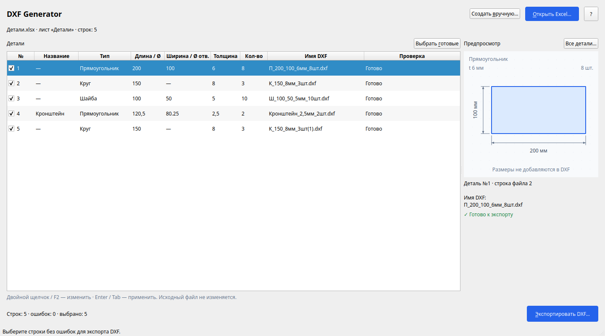
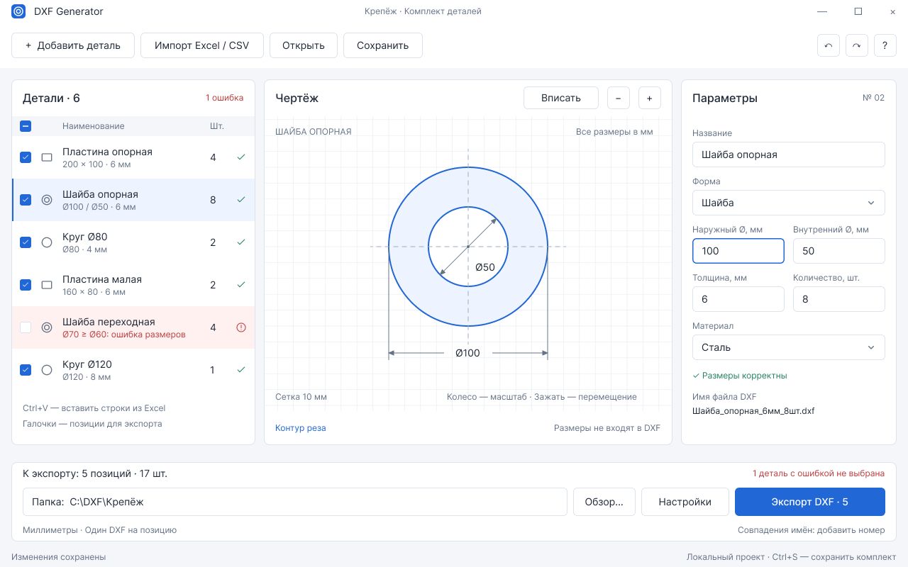

# DXF Generator

Небольшая офлайн-утилита для подготовки DXF плоских деталей. Новое приложение на **C++20 + Qt Widgets**, разработка на Linux, целевая платформа — **Windows 10/11 x64**. Это новая кодовая база, без переноса WinForms и его зависимостей.

## Основной сценарий

**Перетащить Excel → проверить список → выбрать папку → получить DXF.** Источник данных — Excel; отдельный файл проекта/комплекта не нужен. Один DXF на позицию, количество передаётся в имени для CAM, а не копиями контуров.

Текущий объём работы: импорт таблицы, понятные ошибки по строкам, предпросмотр выбранной детали и экспорт с совместимыми именами. CSV, раскладка и расширение ручного редактора в этот этап не входят.

## Текущее состояние

Рабочий каркас 0.1: список деталей с включением в экспорт, редактор прямоугольника/круга/шайбы, предпросмотр, проверка размеров и пакетное сохранение DXF. Имя DXF видно до экспорта. Название необязательно: пустое даёт имя из типа и размеров. Порядок полей и суффиксы повторов `(1)`, `(2)` взяты из старого кода; дробные числа в имени всегда с запятой по требованию CAM. Недопустимые имена и уже занятые пути отклоняются до записи пакета. [Правила и примеры имён](docs/cam-filenames.md).

Параметры пока живут **в памяти**, импорт Excel ещё не реализован. Следующий этап — `.xlsx` и основной экран загрузки списка. Текущий экран и исходный макет ниже показывают промежуточный ручной редактор; его предстоит упростить под основной сценарий.



<details>
<summary>Исходный прототип интерфейса</summary>



</details>

DXF: ASCII AC1015 (AutoCAD 2000), миллиметры, слой `CUT`, точные `CIRCLE` и замкнутые `LWPOLYLINE`. Размерные линии видны только в предпросмотре. Проверка независимым парсером не заменяет проверку на конкретной CAD/CAM-системе или станке.

## Сборка на Linux

Нужны CMake ≥ 3.25, Ninja, компилятор C++20 и Qt ≥ 6.4 с Core/Gui/Widgets. На Ubuntu/Mint пакеты: `build-essential cmake ninja-build qt6-base-dev libgl1-mesa-dev`. На машине разработки уже установленный Qt используется без скачивания нового SDK.

```sh
cmake --preset dev-linux
cmake --build --preset dev-linux --parallel 4
ctest --preset dev-linux
./build/dev-linux/dxf-generator
```

Профиль `release-linux` включает оптимизацию размера и IPO. Все результаты находятся в игнорируемой `build/`; настройки машины можно добавить в игнорируемый `CMakeUserPresets.json`.

Проверить ядро вообще без Qt:

```sh
cmake --preset core-only
cmake --build --preset core-only
ctest --preset core-only
```

`sanitize-linux` проверяет ядро с ASan/UBSan. Для снимка настоящего окна без рабочего стола:

```sh
QT_QPA_PLATFORM=offscreen ./build/dev-linux/dxf-generator --screenshot build/window.png
```

## Запуск из VS Code на Linux

Открыть **папку проекта целиком**. Нужны расширения C/C++ (`ms-vscode.cpptools`), CMake Tools (`ms-vscode.cmake-tools`) и GDB. Рекомендации расширений сохранены в `.vscode/extensions.json`. В `.vscode` находятся общие настройки проекта, глобальные настройки редактора не требуются.

- **F5** — собрать Debug и запустить `DXF Generator (Linux Debug)` с отладчиком. Точки останова работают в C++-исходниках.
- **Ctrl+F5** — собрать и запустить без отладки.
- **Ctrl+Shift+B** — сконфигурировать и собрать профиль `dev-linux`.
- **Терминал → Выполнить задачу → DXF: run** — обычный запуск приложения.
- **Терминал → Выполнить задачу → DXF: test** — сборка и CTest.

Запуск по F5 использует явный путь к приложению и не зависит от выбранной в CMake Tools тестовой цели. Конфигурация выполняется задачей перед сборкой; при открытии папки мастер выбора компилятора не запускается. Быстрая кнопка C/C++ для сборки отдельного активного файла скрыта; используйте F5 или панель «Запуск и отладка». C/C++ берёт стандарт языка, Qt include paths и определения из `build/dev-linux/compile_commands.json`. Настройки запуска рассчитаны на Linux; Windows EXE собирается отдельно описанным ниже способом.

## Windows и один EXE

Для обычной разработки: MSVC 2022 x64, Ninja и Qt 6.10.3 MSVC 2022, терминал с окружением компилятора и Qt в `CMAKE_PREFIX_PATH`:

```powershell
cmake --preset dev-windows
cmake --build --preset dev-windows
ctest --preset dev-windows
```

Релизный профиль `release-windows-static` требует **отдельно собранный статический Qt** и `QT_STATIC_ROOT`. Он отвергает динамический Qt; одной настройки CMake недостаточно, чтобы превратить обычный Qt SDK в один EXE. Цель — один EXE без Qt/MSVC/MinGW DLL рядом, с использованием системных DLL Windows.

В Actions есть обычный CI Linux/Windows и отдельный ручной workflow **Windows single EXE (manual)**: сборка минимального QtBase, статический runtime, импорт Windows-плагина, тесты и проверка PE-зависимостей. Это процесс получения тестового артефакта, а не публикация готового релиза. Подробности: [сборка Windows](docs/windows-single-exe.md), [условия распространения](docs/licensing.md).

**Проверено 2026-10-19:** один EXE **17 053 696 байт (16,26 МиБ / 17,05 МБ)**, без упаковщика и без внешних Qt/CRT DLL. Запуск окна, проверки CAM-имён, файловые и геометрические тесты прошли на Windows runner; PE-аудит обычных и отложенных импортов прошёл. [Успешная статическая сборка](https://github.com/DenisPapushaJava/dxf-generator/actions/runs/39318786724). В ручном CI действует бюджет 20 МиБ. Проверка на чистых Windows 10/11 и конкретной CAD/CAM ещё впереди.

## Зависимости и устройство

| Задача | Решение сейчас |
| --- | --- |
| Геометрия, валидация, DXF | Стандартная библиотека C++20, без Qt |
| Окно, модель списка, рисование | Qt Core + Gui + Widgets |
| Файлы, Unicode, безопасные имена | Qt Core |
| Проверки ядра и файлов | CTest + небольшие тестовые исполняемые файлы |
| Независимый аудит DXF | ezdxf 1.4.3 **только в окружении проверок**, не в приложении |
| Excel `.xlsx`, следующий этап | Выбран QXlsx; пока не скачивается и не собирается |

В обычной конфигурации нет `FetchContent`, загрузки пакетов или обращения приложения к сети. Не используются QML, WebEngine, Qt Network/SQL, OpenCascade, .NET, Python runtime. [Обоснование зависимостей](docs/dependencies.md), [архитектура и дальнейшие этапы](docs/architecture.md).

## Проверки DXF

Необязательная проверка другим парсером в отдельном окружении разработки (нужен пакет `python3-venv`):

```sh
python3 -m venv build/dxf-audit
build/dxf-audit/bin/pip install ezdxf==1.4.3
build/core-only/dxfgen_fixture build/fixtures
build/dxf-audit/bin/python scripts/check_dxf.py build/fixtures
```

Она проверяет единицы, типы и число контуров, размеры, замыкание прямоугольника, концентричность шайбы и отсутствие исправлений при DXF-аудите.

## Лицензия

Лицензия нового проекта пока не выбрана автором. Публичность репозитория сама по себе не предоставляет открытую лицензию. Условия Qt и будущих зависимостей описаны в [docs/licensing.md](docs/licensing.md).
